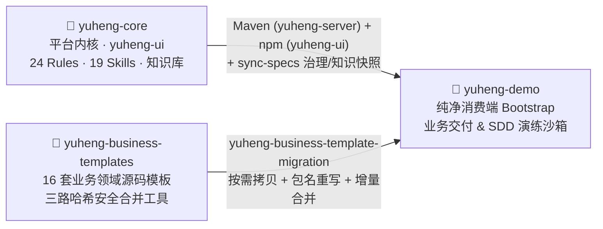
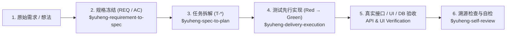

<div align="center">

# 🌌 Yuheng Core (聿珩)

**基于 RuoYi (`ruoyi-vue-pro`) AI 化重构的企业级底座与自动化 SDD（Spec-Driven Development）工程治理内核**

[](https://openjdk.org/)
[](https://spring.io/projects/spring-boot)
[](https://vuejs.org/)
[](https://www.typescriptlang.org/)
[](#ai-自动化-sdd-spec-driven-development-引擎)
[](https://github.com/huhua1990/yuheng-core/pulls)

[简体中文](./README.md) · [构建指南](./BUILD.md) · [SDD 工作流](./docs/development/sdd-workflow.md) · [消费端脚手架 (yuheng-demo)](https://github.com/huhua1990/yuheng-demo) · [业务模板库 (yuheng-business-templates)](https://github.com/huhua1990/yuheng-business-templates)

</div>

---

## 💡 为什么重构 RuoYi？从「传统单体」到「AI 原生 SDD 平台」

传统的 RuoYi (`ruoyi-vue-pro`) 是极为优秀的 Java/Vue 企业级快速开发框架，但在 **AI 编程代理（Claude Code / Codex / Cursor / Antigravity / Qoder）主导开发** 的新时代，传统单体工程面临三大核心痛点：

| 痛点维度 | 传统 RuoYi + Vibe Coding（随意提示词开发） | Yuheng（聿珩）AI 原生重构 + SDD 工程体系 |
| :--- | :--- | :--- |
| **上下文爆炸** | 数十万行业务代码与平台底座混杂，AI 上下文窗口被无关业务塞满，推理成本高、易迷失 | **三仓解耦架构**：平台内核（`yuheng-core`）、消费端脚手架（`yuheng-demo`）、业务模板库（`yuheng-business-templates`）彻底分离 |
| **API 幻觉与破坏边界** | AI 容易编造不存在的 `Request`/`Store`/Mapper 接口，或直接魔改底层通用组件导致难以升级 | **结构化知识底座（`ai-knowledge-core`）+ 版本化消费**：消费端通过 Maven/npm 消费底座契约，只读知识索引锚定真实 API |
| **代码质量不可控** | 跳过需求分析与测试直接生成代码，缺少验收闭环，往往“改一处崩三处” | **内建 SDD 治理引擎（24 条 Rules + 19 个 Skills）**：强制 `需求 → 规格 → 计划 → TDD 红绿实现 → 真实接口/UI/DB 验收 → 自检` |

---

## 🌐 Yuheng 开源生态三剑客

Yuheng 采用**「版本化平台底座 + 纯净消费端 + 按需拷贝业务模板」**的现代开源工程拓扑：



| 仓库 | 定位与职责 | 仓库地址 |
| :--- | :--- | :--- |
| **`yuheng-core`** *(本仓库)* | 平台公共能力底座（System / Infra / Framework Starters / `yuheng-ui`）、AI 知识库与 SDD 治理规则/技能源 | [`huhua1990/yuheng-core`](https://github.com/huhua1990/yuheng-core) |
| **`yuheng-demo`** | 消费端工程标杆与纯净启动脚手架（无预设业务模板膨胀），演示如何通过 AI SDD 交付业务 | [`huhua1990/yuheng-demo`](https://github.com/huhua1990/yuheng-demo) |
| **`yuheng-business-templates`** | 16 个企业级业务领域源码模板（ERP/CRM/BPM/AI/IoT/MES 等），支持包名自动重写与三路合并升级 | [`huhua1990/yuheng-business-templates`](https://github.com/huhua1990/yuheng-business-templates) |

---

## 🏗️ 核心架构与目录结构

`yuheng-core` 将 Java 平台包名统一规范为 `com.yuheng.platform`，前端抽象为独立 npm 包 `yuheng-ui`（含全新 Runtime 与向后兼容 `compat` 导出层）：

```text
yuheng-core/
├── yuheng-dependencies/          # 统一 BOM 与第三方依赖版本仲裁
├── yuheng-framework/             # 15 个企业级 Starter（mybatis/redis/security/web/mq/job/tenant/data-permission 等）
├── yuheng-module-system/         # 平台系统域（用户、角色、菜单、部门、租户、字典、OAuth2、审计日志等）
├── yuheng-module-infra/          # 平台基础设施域（代码生成、文件存储、定时任务、配置、API 日志等）
├── yuheng-server/                # 平台聚合包 & Liquibase MySQL 基线迁移（001~010）
├── yuheng-ui/                    # Vue 3 + TypeScript + Element Plus 平台前端包（支持 strict consumer 契约）
├── governance/                   # 🛡️ AI 治理唯一真相源
│   ├── rules/                    # 24 份工程/架构/数据库/安全/SDD 强约束规则
│   └── skills/                   # 19 个可编排 AI SDD 技能（含模板资产）
├── ai-knowledge-core/            # 📚 面向 AI 的结构化框架知识库（server / ui / data）
├── release/                      # 版本清单（yuheng-manifest.yaml）与兼容性矩阵
├── tools/governance/             # 自动化治理校验与多 Agent 入口同步工具
├── AGENTS.md / CLAUDE.md         # AI 编码代理统一入口（自动发现 .agents / .claude / .qoder）
└── yuheng-core.sh                # 一键构建、安装本地 Maven/npm 产物脚本
```

---

## 🤖 AI 自动化 SDD（Spec-Driven Development）引擎

`yuheng-core` 不仅是一个代码框架，更内置了一整套可被 AI 代理直接执行的 **SDD 规范驱动开发流水线**：



### 核心 AI 资产一览

1. **19 个 SDD 技能（`governance/skills/`）**：
   * **全流程编排**：`yuheng-workflow-router`（阶段路由）、`yuheng-full-workflow`（端到端交付）、`yuheng-brainstorming`
   * **规格与计划**：`yuheng-requirement-to-spec`、`yuheng-spec-to-plan`、`yuheng-task-decomposition`、`yuheng-writing-plans`
   * **执行与交付**：`yuheng-delivery-execution`、`yuheng-backend-delivery`、`yuheng-page-delivery`、`yuheng-menu-delivery`、`yuheng-business-template-migration`
   * **测试与验证**：`test-driven-development`、`yuheng-api-verification`、`yuheng-ui-verification`、`verification-before-completion`、`yuheng-self-review`
   * **环境与知识**：`yuheng-init-project-postcheck`、`yuheng-knowledge-routing`
2. **多 AI 工具开箱即用**：
   * 原生适配 **Claude Code**（`.claude/skills/` + `CLAUDE.md`）、**Codex / Antigravity**（`.agents/skills/` + `AGENTS.md`）与 **Qoder**（`.qoder/skills/`），均通过相对符号链接指向 `governance/skills/`，零副本漂移。
3. **快速唤起示例**：
   ```text
   $yuheng-workflow-router
   我要新增一个可复用的业务字典查询能力，请先检查已有接口，再判断当前 SDD 阶段。
   ```

---

## 🚀 快速开始

### 环境要求

* **JDK**: 17+
* **Maven**: 3.9+
* **Node.js**: 20.19+ 或 22.12+（包管理器 **pnpm 9.x**）
* **Python**: 3.9+（用于运行治理检查与资产同步工具）

### 1. 构建并安装平台底座到本地仓库

使用根目录一键脚本（详细命令参见 [BUILD.md](./BUILD.md)）：

```bash
# 1. 编译安装后端 Maven 产物到本地仓库 + 构建打包前端 yuheng-ui (.tgz)
./yuheng-core.sh install

# 2. 若需同时将前端包同步到同级 ../yuheng-demo 项目测试
./yuheng-core.sh release
```

或分步执行标准命令：

```bash
# 后端编译与打包
mvn -B -DskipTests package

# 前端依赖安装、单测、严格类型检查、构建与边界校验
cd yuheng-ui
pnpm install --ignore-workspace --frozen-lockfile
pnpm test
pnpm run typecheck
pnpm run build
pnpm run lint:boundary
```

### 2. 运行 AI 治理与资产一致性检查

```bash
# 检查多 Agent 技能软链接是否完整（只读，不修改文件）
python3 tools/governance/sync_agent_assets.py --check

# 校验发布清单与治理包完整性
python3 tools/governance/verify_manifest.py release/yuheng-manifest.yaml --json
python3 tools/governance/verify_bundle.py . --json

# 运行治理工具单元测试
python3 -m unittest discover -s tools/governance/tests -v
```

---

## 🛠️ 技术栈版本

| 层级 | 核心技术与版本 |
| :--- | :--- |
| **后端底座** | Java 17 · Spring Boot 3.5.15 · MyBatis Plus · Liquibase · Spring Security · Flowable · Quartz |
| **数据与缓存** | MySQL 8.0+ · Redis · Redisson |
| **前端底座 (`yuheng-ui`)** | Vue 3.5.34 · TypeScript 6.0.3 · Vite 8.1.4 · Element Plus 2.13.7 · Pinia 3.0.4 · Vue Router 5.0.6 · Vitest 3.2.4 |
| **AI SDD 治理** | Python Governance CLI · JSON/YAML Manifest · Markdown Spec/Plan/Verification Traceability |

---

## 🤝 参与贡献

欢迎通过 Issue 或 Pull Request 参与共建！贡献平台能力或 AI 治理资产前，请阅读：

* [AGENTS.md](./AGENTS.md) — AI/人类通用的技术边界与 SDD 开发入口
* [docs/development/sdd-workflow.md](./docs/development/sdd-workflow.md) — 完整 SDD 开发与验收规范

> 致谢：本项目核心企业级能力重构自开源项目 [ruoyi-vue-pro](https://gitee.com/zhijiantianya/ruoyi-vue-pro)（芋道源码），特此致敬。
