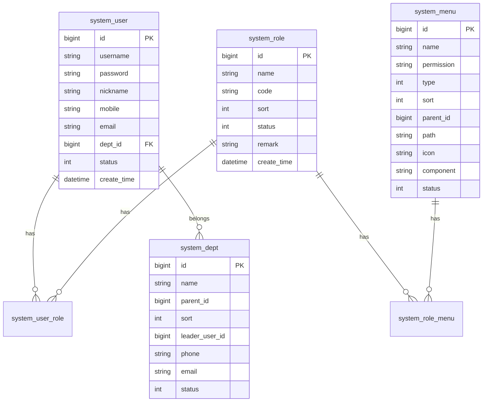

# Yuheng Server 数据库关系

本文档描述 Yuheng 系统的核心数据库表结构和关系。

---

## 核心表结构

### 用户与权限

---

## 系统管理

### system_user（用户表）

| 字段 | 类型 | 说明 |
|------|------|------|
| id | bigint | 主键 |
| username | varchar(30) | 用户账号 |
| password | varchar(100) | 密码（加密） |
| nickname | varchar(30) | 用户昵称 |
| remark | varchar(500) | 备注 |
| dept_id | bigint | 部门ID |
| post_ids | varchar(255) | 岗位ID数组 |
| email | varchar(50) | 邮箱 |
| mobile | varchar(11) | 手机号 |
| sex | tinyint | 性别 |
| avatar | varchar(512) | 头像 |
| status | tinyint | 状态：0正常 1停用 |
| login_ip | varchar(50) | 最后登录IP |
| login_date | datetime | 最后登录时间 |
| creator | varchar(64) | 创建者 |
| create_time | datetime | 创建时间 |
| updater | varchar(64) | 更新者 |
| update_time | datetime | 更新时间 |
| deleted | bit | 是否删除 |
| tenant_id | bigint | 租户ID |

### system_role（角色表）

| 字段 | 类型 | 说明 |
|------|------|------|
| id | bigint | 主键 |
| name | varchar(30) | 角色名称 |
| code | varchar(100) | 角色权限字符串 |
| sort | int | 显示顺序 |
| data_scope | tinyint | 数据范围：1全部 2自定义 3本部门 4本部门及以下 5仅本人 |
| data_scope_dept_ids | varchar(500) | 数据范围（部门ID数组） |
| status | tinyint | 状态：0正常 1停用 |
| type | tinyint | 角色类型：1内置角色 2自定义角色 |
| remark | varchar(500) | 备注 |
| creator | varchar(64) | 创建者 |
| create_time | datetime | 创建时间 |
| updater | varchar(64) | 更新者 |
| update_time | datetime | 更新时间 |
| deleted | bit | 是否删除 |
| tenant_id | bigint | 租户ID |

### system_menu（菜单表）

| 字段 | 类型 | 说明 |
|------|------|------|
| id | bigint | 主键 |
| name | varchar(50) | 菜单名称 |
| permission | varchar(100) | 权限标识 |
| type | tinyint | 类型：1目录 2菜单 3按钮 |
| sort | int | 显示顺序 |
| parent_id | bigint | 父菜单ID |
| path | varchar(200) | 路由地址 |
| icon | varchar(100) | 菜单图标 |
| component | varchar(255) | 组件路径 |
| component_name | varchar(255) | 组件名 |
| status | tinyint | 状态：0正常 1停用 |
| visible | bit | 是否可见 |
| keep_alive | bit | 是否缓存 |
| always_show | bit | 是否总是显示 |
| creator | varchar(64) | 创建者 |
| create_time | datetime | 创建时间 |
| updater | varchar(64) | 更新者 |
| update_time | datetime | 更新时间 |
| deleted | bit | 是否删除 |

### system_dept（部门表）

| 字段 | 类型 | 说明 |
|------|------|------|
| id | bigint | 主键 |
| name | varchar(30) | 部门名称 |
| parent_id | bigint | 父部门ID |
| sort | int | 显示顺序 |
| leader_user_id | bigint | 负责人ID |
| phone | varchar(11) | 联系电话 |
| email | varchar(50) | 邮箱 |
| status | tinyint | 状态：0正常 1停用 |
| creator | varchar(64) | 创建者 |
| create_time | datetime | 创建时间 |
| updater | varchar(64) | 更新者 |
| update_time | datetime | 更新时间 |
| deleted | bit | 是否删除 |
| tenant_id | bigint | 租户ID |

---

## 字典配置

### system_dict_type（字典类型表）

| 字段 | 类型 | 说明 |
|------|------|------|
| id | bigint | 主键 |
| name | varchar(100) | 字典名称 |
| type | varchar(100) | 字典类型 |
| status | tinyint | 状态 |
| remark | varchar(500) | 备注 |
| creator | varchar(64) | 创建者 |
| create_time | datetime | 创建时间 |
| updater | varchar(64) | 更新者 |
| update_time | datetime | 更新时间 |
| deleted_time | datetime | 删除时间 |
| deleted | bit | 是否删除 |

### system_dict_data（字典数据表）

| 字段 | 类型 | 说明 |
|------|------|------|
| id | bigint | 主键 |
| sort | int | 显示顺序 |
| label | varchar(100) | 字典标签 |
| value | varchar(100) | 字典键值 |
| dict_type | varchar(100) | 字典类型 |
| status | tinyint | 状态 |
| color_type | varchar(100) | 颜色类型 |
| css_class | varchar(100) | CSS类名 |
| remark | varchar(500) | 备注 |
| creator | varchar(64) | 创建者 |
| create_time | datetime | 创建时间 |
| updater | varchar(64) | 更新者 |
| update_time | datetime | 更新时间 |
| deleted | bit | 是否删除 |

---

## 参数配置

### system_config（参数配置表）

| 字段 | 类型 | 说明 |
|------|------|------|
| id | int | 主键 |
| category | varchar(50) | 参数分组 |
| type | tinyint | 参数类型 |
| name | varchar(100) | 参数名称 |
| config_key | varchar(100) | 参数键名 |
| value | varchar(500) | 参数键值 |
| visible | bit | 是否可见 |
| remark | varchar(500) | 备注 |
| creator | varchar(64) | 创建者 |
| create_time | datetime | 创建时间 |
| updater | varchar(64) | 更新者 |
| update_time | datetime | 更新时间 |
| deleted | bit | 是否删除 |

---

## 日志记录

### system_operate_log（操作日志表）

| 字段 | 类型 | 说明 |
|------|------|------|
| id | bigint | 主键 |
| trace_id | varchar(64) | 链路追踪ID |
| user_id | bigint | 用户ID |
| user_type | tinyint | 用户类型 |
| module | varchar(50) | 模块标题 |
| name | varchar(50) | 操作名 |
| type | bigint | 操作分类 |
| content | varchar(2000) | 操作内容 |
| exts | varchar(512) | 拓展字段 |
| request_method | varchar(16) | 请求方法 |
| request_url | varchar(255) | 请求地址 |
| user_ip | varchar(50) | 用户IP |
| user_agent | varchar(200) | 浏览器UA |
| java_method | varchar(512) | Java方法名 |
| java_method_args | varchar(8000) | Java方法参数 |
| start_time | datetime | 开始时间 |
| duration | int | 执行时长（毫秒） |
| result_code | int | 结果码 |
| result_msg | varchar(512) | 结果提示 |
| result_data | varchar(4000) | 结果数据 |
| creator | varchar(64) | 创建者 |
| create_time | datetime | 创建时间 |
| updater | varchar(64) | 更新者 |
| update_time | datetime | 更新时间 |
| deleted | bit | 是否删除 |
| tenant_id | bigint | 租户ID |

---

## 文件管理

### infra_file（文件表）

| 字段 | 类型 | 说明 |
|------|------|------|
| id | bigint | 主键 |
| config_id | bigint | 配置ID |
| name | varchar(256) | 文件名 |
| path | varchar(512) | 文件路径 |
| url | varchar(1024) | 文件URL |
| type | varchar(128) | 文件类型 |
| size | int | 文件大小 |
| creator | varchar(64) | 创建者 |
| create_time | datetime | 创建时间 |
| updater | varchar(64) | 更新者 |
| update_time | datetime | 更新时间 |
| deleted | bit | 是否删除 |

---

## 关系说明

### 用户-角色-菜单

- 一个用户可以有多个角色（system_user_role）
- 一个角色可以有多个菜单（system_role_menu）
- 一个用户通过角色获得菜单权限

### 部门层级

- 部门采用树形结构（parent_id）
- 用户归属于某个部门（dept_id）

### 字典管理

- 字典类型（system_dict_type）定义字典分类
- 字典数据（system_dict_data）属于某个字典类型

---

**版本**: 0.1.0-SNAPSHOT  
**更新时间**: 2026-11-09
