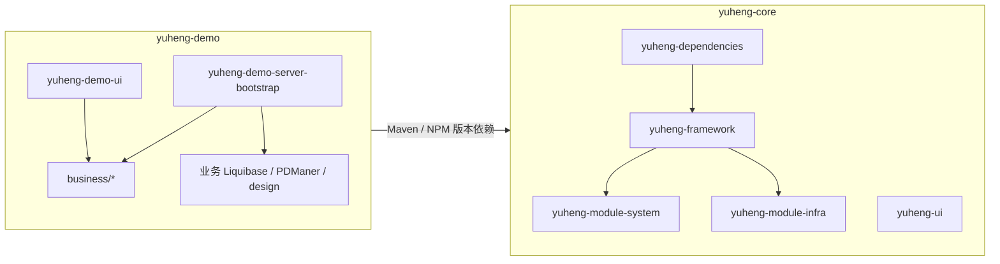
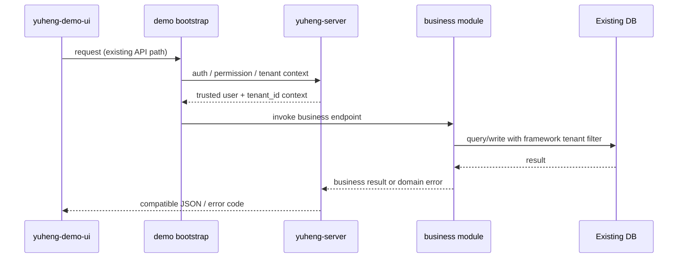

# Yuheng 架构改造设计

日期：2026-10-24  
状态：已确认，可进入实施计划阶段  
范围：理解 Athena（`athena-core` + `demo`）的架构思想，设计将 `ruoyi-vue-pro` 演进为名为 `yuheng` 的可复用框架与消费端体系。

## 1. 背景与目标

Athena 的关键思想是把框架能力和产品业务分成两个独立生命周期：

- `athena-core` 只产出可复用的后端库和前端 NPM 包，不承载业务域代码；
- `demo` 作为母版/消费端，负责启动、数据库迁移、业务模块和产品页面；
- 消费端通过版本化依赖使用 core，而不是修改 core 源码；
- core 的 API、数据库关系、运行配置、扩展点和知识文档形成稳定的消费契约；
- 复杂能力（插件宿主、多库作用域、微服务）按实际需求演进，不作为业务项目的首轮接入前置条件。

`ruoyi-vue-pro` 当前已经具备较强的模块化单体基础，但 root、framework、system、infra、server 和前端应用仍然处于同一产品生命周期。改造目标是建立 `yuheng-core` 与 `yuheng-demo` 的边界，同时保持现有数据库、核心 REST API、JSON 契约和共享库 `tenant_id` 语义。

本设计只定义架构、边界、迁移路线和验收标准，不直接改造业务代码。

## 2. 已确认的设计决策

1. **最终形态**：`yuheng-core` + `yuheng-demo` 两个可独立发布的工程。
2. **迁移方式**：先在原仓库内完成逻辑分层，再拆 Git 仓库和发布线。
3. **运行形态**：首轮保持模块化单体；微服务只作为后续按压力触发的部署演进。
4. **core 范围**：平台底座、`system` 通用管理能力和 `infra` 基础设施能力进入 core。
5. **前端基线**：只支持 Vue3 + Element Plus，发布 `yuheng-ui` NPM 包；Vue2、Vben、UniApp 不进入首版基线。
6. **租户模型**：首轮保留 ruoyi 的共享库行级 `tenant_id` 模型，不引入 Athena 的 `single` / `multi-db` 作用域路由。
7. **兼容目标**：优先保持数据库表与字段、核心 API 路径、请求/响应 JSON、错误码和既有业务行为。
8. **包名策略**：第一阶段保留 `cn.iocoder.boot` Java 包名，避免把仓库拆分、包名重写和行为改造叠加在一起；`com.yuheng` 命名空间作为后续独立迁移事项。
9. **发布产物**：对消费端暴露 `yuheng-server` 和 `yuheng-ui` 两个稳定产物；core 内部模块随同一版本线发布，避免 system、infra 和 framework 版本漂移。
10. **后续扩展**：插件宿主、multi-db 和微服务适配预留稳定接口，但不作为首轮迁移依赖。

## 3. 目标架构



### 3.1 yuheng-core

`yuheng-core` 是框架产品，不是业务应用。内部保留多 Maven 模块以便维护，但首版对消费端提供两个稳定入口：

- `yuheng-server`：聚合 framework、system、infra 和公共扩展契约；
- `yuheng-ui`：提供 Vue3 + Element Plus 的运行时、页面基座和通用组件。

内部边界如下：

- `yuheng-dependencies`：统一 Java、Spring Boot、MyBatis、Redis、任务、消息、监控和前端依赖版本；
- `yuheng-framework`：统一响应、异常、Web、认证、权限、租户 `tenant_id`、MyBatis、缓存、文件、日志、任务、消息和监控；
- `yuheng-module-system`：用户、角色、部门、菜单、租户、字典、通知、OAuth2 等通用管理能力；
- `yuheng-module-infra`：配置、文件、代码生成、定时任务、日志和数据库工具等平台能力；
- `yuheng-ui`：登录、布局、路由、权限守卫、用户/角色/部门/租户 Store、请求层、通用组件以及 system/infra 平台页面。

首轮不强制重写现有 `controller/service/dal/framework` 包结构。先稳定所有权和依赖方向，再单独进行领域包结构收敛。

### 3.2 yuheng-demo

`yuheng-demo` 是母版/示例消费端，可以复制成具体产品：

- `yuheng-demo-server-bootstrap`：唯一正式启动入口，负责 Spring Boot、数据源、Liquibase、运行配置、组件装配和打包；
- `business/*`：BPM、支付、商城、CRM、ERP 等业务域模块；
- `yuheng-demo-ui`：消费 `yuheng-ui`，承载业务 API、业务页面和业务路由；
- 业务 Liquibase、PDManer 唯一模型和 `design/` 设计文档。

业务模块只依赖 `yuheng-server` 的公共契约，不修改 core 内部实现，也不重复实现 core 的认证、租户、权限、请求和菜单缓存机制。

### 3.3 依赖方向

```text
产品业务模块 / yuheng-demo
            ↓
       yuheng-server
            ↓
   yuheng-framework + system + infra
```

core 不依赖 business。消费端不通过源码引用 core 的内部类；需要扩展时使用公开 API、SPI、事件或配置契约。

## 4. ruoyi 模块映射

| ruoyi-vue-pro 现状 | yuheng 目标归属 | 首轮策略 |
|---|---|---|
| `yudao-dependencies` | `yuheng-dependencies` | 作为 core 唯一版本 BOM |
| `yudao-framework/*` | `yuheng-framework` | 保留 starter 能力和已有依赖边界 |
| `yudao-module-system` | `yuheng-module-system` | 进入 core，随 `yuheng-server` 发布 |
| `yudao-module-infra` | `yuheng-module-infra` | 进入 core，随 `yuheng-server` 发布 |
| `yudao-server` | `yuheng-demo-server` + `yuheng-demo-server-bootstrap` | 拆成消费端聚合器和运行启动模块 |
| `yudao-module-bpm/pay/mall/crm/erp/...` | `yuheng-demo/business/*` | 按业务域逐个迁移，暂不进入 core |
| `yudao-ui/yudao-ui-admin-vue3` | `yuheng-ui` + `yuheng-demo-ui` | 按平台/业务职责拆分 |
| Vue2、Vben、UniApp | 后续适配层 | 首版不纳入基线 |

前端拆分时，平台运行时、登录、布局、路由守卫、Store、请求层、通用组件和 system/infra 页面进入 `yuheng-ui`；业务 API、业务页面和业务菜单留在 `yuheng-demo-ui`。

## 5. 请求、数据和错误流



### 5.1 租户与权限

首轮继续使用 ruoyi 的共享库 `tenant_id` 语义：

- 租户从可信登录会话恢复，不能信任请求体中的任意 `tenantId`；
- framework 负责租户过滤、写入和上下文清理；
- 业务 Service 只处理当前上下文中的业务规则和业务授权；
- 用户、角色、部门、菜单和数据权限继续使用已有语义；
- 不把 `single` / `multi-db`、目标数据库参数或跨租户循环引入普通业务。

### 5.2 数据库迁移

数据库迁移由两部分组合：

1. **core baseline**：框架、system、infra 的表和基础数据；
2. **demo business**：业务表、索引、种子数据和业务增量。

`yuheng-demo-server-bootstrap` 的 entry changelog 固定组合两条链，并保留 `DATABASECHANGELOG` 记录。已有 ruoyi 数据库优先复用表名、字段、索引和数据，只增加经过验证的增量迁移。已执行 changeset 不修改，不使用忽略全部错误掩盖失败。

### 5.3 错误责任

- 认证失败、权限失败、租户隔离、参数校验、框架异常和统一错误码由 core 负责；
- 领域状态冲突、业务规则和业务授权由 demo 业务模块负责；
- 对外继续保持现有 HTTP、JSON、分页和错误码契约；
- 未来拆为微服务时，保持 DTO、错误码、服务接口和事件契约不变，只替换适配器。

## 6. 迁移阶段与门禁

### 阶段 0：基线盘点

建立并冻结以下清单：

- Maven 模块依赖图和 Spring 组件扫描范围；
- 核心 REST API、DTO、JSON、错误码和前端调用；
- 数据库表、索引、Liquibase 入口和数据快照；
- 前端路由、Store、axios、动态菜单和全局配置；
- 启动参数、静态资源、代码生成器和反射/服务加载点。

门禁：兼容矩阵、依赖图、数据库快照和核心 API 清单齐全。

### 阶段 1：仓库内逻辑分层

在原仓库内先形成 `yuheng-core` / `yuheng-demo` 的逻辑边界：

- framework、system、infra 只属于 core；
- server bootstrap、业务模块和业务 UI 只属于 demo；
- core 能独立编译和测试；
- core 不依赖业务；
- 旧 API、数据库升级和 Vue3 前端回归通过。

门禁：依赖边界和兼容测试通过后，才允许拆仓库。

### 阶段 2：发布线外置

拆成两个 Git 仓库，发布：

- Maven：`com.yuheng:yuheng-server`；
- NPM：`yuheng-ui`。

demo 只消费版本化产物，不引用 core 源码。后端和前端使用同一条版本线，并同步锁文件、API 清单、数据模型和运行配置契约。

门禁：使用干净环境，仅安装 core 产物即可构建和启动 demo。

### 阶段 3：业务模块迁移

按业务域逐个把 BPM、支付、商城、CRM、ERP 等迁入 `yuheng-demo/business/*`。每个模块需提供：

- 业务 API 和菜单清单；
- 业务 Liquibase 和 PDManer 更新；
- 正常、失败、权限和租户行为测试；
- 前端构建和关键页面回归证据。

### 阶段 4：按需演进

在有明确收益时再引入：

- 插件宿主和可安装业务模块；
- `single` / `multi-db` 运行作用域；
- 独立业务服务、网关和消息契约。

这些能力必须通过独立设计和兼容评估，不作为首轮改造的隐含范围。

## 7. 风险与控制

| 风险 | 控制措施 |
|---|---|
| system/infra 依赖 root 启动、组件扫描和静态资源 | 阶段 0 建立扫描清单；阶段 1 先做独立启动与组件发现测试 |
| tenant_id 或数据权限语义变化 | 保留现有上下文和拦截器；使用真实数据库做隔离回归 |
| core/demo Liquibase 重复或漏执行 | 单一 entry changelog；校验 include 顺序和重复执行 |
| 前端全局 Store、axios、菜单和路由耦合 | 只保留一套 `yuheng-ui` request/Store；业务页面通过公开入口接入 |
| API 或 JSON 不兼容 | 建立核心 API 快照测试和旧前端调用回归 |
| core 与 demo 版本漂移 | 单一版本线、锁文件检查和消费端兼容矩阵 |
| 包名重写扩大变更面 | 第一阶段保留 `cn.iocoder.boot`；命名空间迁移独立立项 |
| 业务代码回流 core | Maven 依赖规则、ArchUnit 和代码审查门禁 |

## 8. 测试与完成标准

### core 必须验证

- 统一响应、异常和错误码契约；
- 认证、权限、`tenant_id` 过滤和上下文清理；
- system/infra API 与数据库集成；
- core baseline 的 Liquibase 初始化和升级；
- `yuheng-server` 独立构建、测试和打包；
- `yuheng-ui` 构建、导出和公共 Store/request 行为。

### demo 必须验证

- 仅依赖版本化 core 产物即可启动；
- 业务模块的规则、权限、数据库读写和迁移；
- 旧数据库升级和核心 API 回归；
- Vue3 + Element Plus 构建、登录、布局、动态菜单和关键业务页面；
- 业务模块不引用 core 内部实现。

### 交付完成条件

1. core 产物不包含业务域代码；
2. demo 在干净环境中仅通过 Maven/NPM 依赖构建和启动；
3. 现有数据库可升级，核心 API、JSON、错误码和 `tenant_id` 行为兼容；
4. 前端基线构建和关键页面回归通过；
5. 依赖边界、迁移检查、测试和发布检查可重复执行；
6. 版本化 API、数据模型、运行配置和扩展点文档随 core 发布。

## 9. 首轮明确不做

- 不直接微服务化；
- 不引入 `single` / `multi-db` 作用域路由；
- 不重写数据库表名和核心 API；
- 不同时重命名所有 Java 包；
- 不把 BPM、支付、商城、CRM、ERP 等业务代码放入 core；
- 不把插件市场、发布审批、客户端安装和热加载作为 core 首轮职责；
- 不为 core 和 demo 各自维护第二套 axios、权限 Store、菜单缓存或租户模型。

