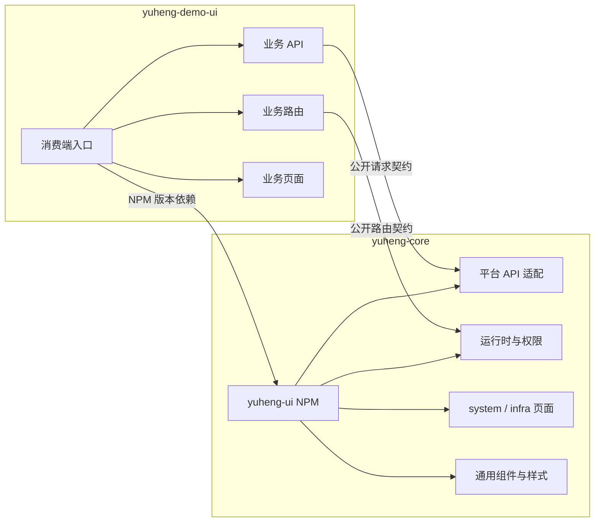
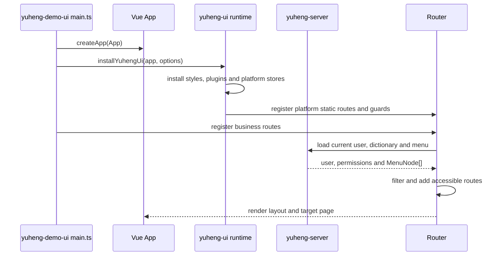
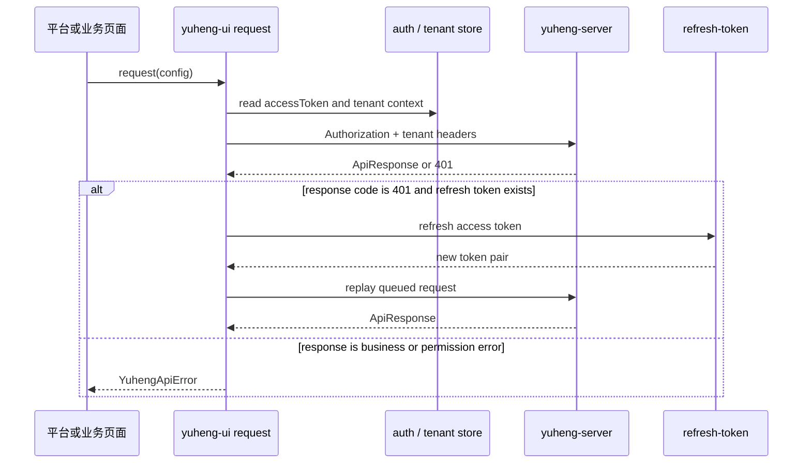

# Yuheng UI 平台包拆分设计

日期：2026-10-25  
状态：已确认设计，待用户审阅规格  
范围：从 `yudao-ui-admin-vue3` 提取 `yuheng-ui` 平台包，供 `yuheng-demo-ui` 作为消费端使用。

## 1. 背景与目标

Yuheng 的前端需要与 Athena 的分层思想一致：平台运行时和通用管理能力由 `yuheng-core` 发布，业务页面和业务扩展由消费端维护。当前前端基线 `/Users/huhua/study/ai/yuheng/yudao-ui-admin-vue3` 把登录、请求、权限、布局、通用组件、system/infra 页面和各业务域页面放在同一个应用中，适合作为迁移源，但不适合作为长期的可复用平台包。

本设计建立 `yuheng-core/yuheng-ui` 的边界和公开契约，目标是：

- 发布一个 Vue 3 + Element Plus 的 `yuheng-ui` NPM 包；
- 把应用运行时、认证请求链路、布局、路由权限、通用组件和 system/infra 页面纳入平台包；
- 让 `yuheng-demo-ui` 只维护业务 API、业务页面、业务路由和产品级覆盖；
- 保持现有后端 API 路径、请求头、JSON 响应、错误码、租户语义和用户操作习惯；
- 让消费端只能通过 `yuheng-ui` 根入口使用平台能力，避免依赖包内源码路径；
- 保持原始 `yudao-ui-admin-vue3` 作为只读基线，不移动、不修改、不把它当作运行时依赖。

本规格定义前端包的职责、目录边界、公开接口、数据流、错误处理、迁移顺序和验收条件，不直接实现代码。

## 2. 已确认的设计决策

1. `yuheng-ui` 位于 `/Users/huhua/study/ai/yuheng/yuheng-core/yuheng-ui`。
2. 第一阶段不新建第三个 Git 仓库，`yuheng-ui` 与 Java core 处于同一 `yuheng-core` 发布线。
3. 平台包首批直接包含 system 和 infra 的生产页面、API 适配和平台路由。
4. `yudao-ui-admin-vue3` 只读，用于追溯和对照；提取工作在 `yuheng-ui` 和 `yuheng-demo-ui` 中完成。
5. 首版只支持 Vue 3、TypeScript、Vite、Element Plus、Pinia、Vue Router 和现有 axios 请求模型。
6. 业务域继续留在消费端，范围为：

   ```text
   ai / ai1 / bpm / crm / erp / fms / hrm / im / iot / mall /
   member / mes / mp / oa / pay / pms / report / wms
   ```

7. 平台和消费端通过公开 TypeScript 契约协作；消费端禁止引用 `yuheng-ui/src/**`。
8. `yuheng-ui` 与 `yuheng-server` 使用同一条发布版本线，消费端通过 NPM 版本依赖接入。

## 3. 范围与非目标

### 3.1 平台包范围

平台包承担以下能力：

| 能力 | 责任 |
| --- | --- |
| 应用启动适配 | Vue 插件安装、平台默认插件、样式和图标注册 |
| 认证与会话 | 登录、退出、刷新令牌、访问令牌存储、登录白名单 |
| 请求基础设施 | axios 实例、API 基础地址、租户请求头、统一响应解析、下载和上传 |
| 权限运行时 | 路由守卫、动态菜单、按钮权限、用户和角色上下文 |
| 应用壳层 | 布局、导航、标签页、页面加载、主题、全局错误页 |
| 平台状态 | 用户、字典、权限、应用配置、标签页和锁屏等 Pinia Store |
| 通用 UI | 表格、表单、分页、弹窗、上传、编辑器、图标和基础业务无关组件 |
| system 模块 | 用户、角色、部门、菜单、租户、岗位、字典、通知、OAuth2、社交和操作日志等平台页面与 API |
| infra 模块 | 配置、文件、代码生成、定时任务、任务日志、访问日志、错误日志、Redis、数据源和平台诊断等页面与 API |
| 国际化与样式 | 平台语言包、主题变量、全局样式、Element Plus 适配 |

### 3.2 消费端范围

`yuheng-demo-ui` 承担以下能力：

- 业务域 API、类型、页面、表单和业务组件；
- 业务菜单元数据和业务动态路由；
- 产品首页、业务工作台和产品级主题覆盖；
- 业务特有的编辑器、图表、流程设计器和第三方插件；
- 对平台公开扩展点的配置和组合。

消费端可以使用平台包导出的通用组件和 Store，但不能复制平台认证、租户请求头、动态权限和菜单缓存逻辑。

### 3.3 非目标

首版不做以下事情：

- 不把业务模块搬入 `yuheng-ui`；
- 不重写后端 API、数据库字段、错误码或租户模型；
- 不同时支持 Vue 2、Vben、UniApp 等其他前端基线；
- 不把平台包改造成独立可运行的业务应用；
- 不为平台包引入微前端、模块联邦或多运行时隔离；
- 不要求一次性拆解所有现有组件；先建立所有权和消费契约，再按实际使用情况收敛内部实现。

## 4. 目标架构



平台包是可安装的运行时和页面集合，不是通过源码复制形成的约定集合。消费端创建自己的 Vue 应用、Pinia 实例和 Router 实例，再通过公开入口安装平台能力和注册业务扩展。

## 5. 平台包内部边界

初始目录只表达所有权，不要求首轮把每个现有文件立即重写成最终形态：

```text
yuheng-ui/
├── package.json
├── tsconfig.json
├── vite.config.ts
├── src/
│   ├── index.ts                  # 唯一公开入口
│   ├── contracts/                # 对外 TypeScript 类型
│   ├── runtime/                  # Vue 插件、初始化和生命周期
│   ├── auth/                     # token、登录态、刷新和登出
│   ├── request/                  # axios、响应解析、租户头和错误转换
│   ├── router/                   # 平台静态路由、动态路由和守卫适配
│   ├── stores/                   # 平台 Pinia Store
│   ├── layout/                   # 应用壳层、导航、标签页和页面容器
│   ├── components/               # 业务无关的可复用组件
│   ├── styles/                   # 主题、变量和全局样式
│   ├── locales/                  # 平台语言包
│   ├── modules/
│   │   ├── system/
│   │   │   ├── api/
│   │   │   ├── routes/
│   │   │   └── views/
│   │   └── infra/
│   │       ├── api/
│   │       ├── routes/
│   │       └── views/
│   └── internal/                 # 不在 exports 中的实现细节
└── README.md
```

平台包可以继续使用现有组件内部的相对引用，但新代码必须使用包内别名或相对路径，不得出现消费端路径别名。`internal/` 只允许被包内模块使用，构建产物和 `package.json.exports` 不暴露它。

### 5.1 平台页面的归属规则

- `src/views/system/**` 中与用户、角色、部门、租户、字典、通知、OAuth2、社交、日志相关的生产页面迁入 `modules/system/views`。
- `src/views/infra/**` 中与配置、文件、代码生成、定时任务、任务日志、访问日志、错误日志、Redis、数据源和平台诊断相关的生产页面迁入 `modules/infra/views`。
- `src/views/infra/demo/**` 仅作为样例或测试页面，不作为稳定平台页面契约；需要保留时放入独立 sample 目录或消费端示例目录，不参与平台路由默认注册。
- `Home`、`Login`、`Error`、`Redirect`、`Profile` 等公共页面按运行时职责进入平台包；业务首页可以通过扩展路由覆盖默认首页。
- 业务目录下的页面、API、类型和业务组件全部留在 `yuheng-demo-ui`。

### 5.2 通用组件的归属规则

只有不依赖业务域 API、业务菜单和业务状态的组件进入平台包。组件如果引用了 BPM、商城、CRM、ERP 等业务 Store 或 API，就留在消费端，即使它当前位于 `src/components`。

## 6. 公开契约

`src/index.ts` 是唯一稳定入口。首版至少导出以下接口和类型：

```ts
export interface YuhengUiOptions {
  apiBaseUrl: string
  appTitle?: string
  basePath?: string
  tenantEnabled?: boolean
  loginPath?: string
  whiteList?: string[]
  requestTimeout?: number
  platformRoutes?: PlatformRouteRecord[]
  onUnauthorized?: (reason: UnauthorizedReason) => void
  onApiError?: (error: YuhengApiError) => void
}

export interface PlatformRouteRecord {
  name: string
  path: string
  component: unknown
  meta?: {
    title?: string
    icon?: string
    permission?: string | string[]
    hidden?: boolean
    keepAlive?: boolean
  }
}

export interface MenuNode {
  id: string | number
  parentId?: string | number | null
  name: string
  path?: string
  component?: string
  permission?: string
  children?: MenuNode[]
}

export interface ApiResponse<T = unknown> {
  code: number
  data: T
  msg?: string
}
```

实际实现可以扩展这些类型，但不能改变已有字段含义。`component` 的具体类型由 Vue Router 版本定义，示例只表示契约形状。

首版公开函数：

```ts
export function installYuhengUi(
  app: App,
  options: YuhengUiOptions
): YuhengUiRuntime

export function registerPlatformRoutes(
  router: Router,
  options?: RegisterPlatformRoutesOptions
): void

export function createYuhengRequest(
  options: YuhengRequestOptions
): YuhengRequest

export const platformRoutes: readonly PlatformRouteRecord[]
```

`YuhengUiRuntime` 暴露可销毁的运行时句柄、平台 Store 访问器和路由注册状态，避免在测试或多实例场景中依赖隐式全局变量。平台包内部仍可以提供 `useUserStore`、`usePermissionStore` 等组合式 API，但它们必须从根入口导出。

### 6.1 请求契约

请求层继续兼容当前 ruoyi 前端约定：

- 默认基础地址由 `apiBaseUrl` 提供，并支持消费端覆盖；
- 登录和刷新令牌接口可以不携带访问令牌；
- 认证头使用 `Authorization: Bearer <token>`；
- 启用租户时发送 `tenant-id`，登录态下按配置发送 `visit-tenant-id`；
- GET 请求保留禁止缓存的请求头；
- 支持 JSON、表单、上传、下载和原始响应；
- 成功响应按 `code` 判断，平台层负责统一解析；
- 业务错误以可识别的 `YuhengApiError` 向消费端抛出，不把业务错误静默转换成成功。

### 6.2 路由契约

消费端通过 `PlatformRouteRecord` 或路由扩展函数添加业务路由。平台包负责：

- 白名单、登录重定向和登录态初始化；
- 动态菜单加载、权限过滤和路由注册；
- 路由重置、页面标题、加载进度和动态导入失败处理。

消费端负责：

- 业务路由的组件和 `meta`；
- 业务菜单的后端数据或配置；
- 首页和产品级路由覆盖。

平台路由名称和路径一旦发布即视为兼容契约。删除或改变路径必须在兼容矩阵中记录迁移策略。

## 7. 应用启动与数据流

### 7.1 启动流程



`main.ts` 仍由消费端持有，平台包不直接创建 `#app`，不假设消费端必须使用某个固定的 `App.vue`。这样平台包能作为库被测试和被不同产品入口复用。

### 7.2 请求流程



刷新令牌只允许有一个并发刷新任务，其他请求进入队列；刷新失败时队列统一结束并触发登出回调。请求层不处理业务页面的重试策略。

## 8. 错误、权限和租户处理

### 8.1 错误责任

| 情况 | 平台包行为 | 消费端责任 |
| --- | --- | --- |
| 网络错误、超时、取消 | 标准化错误类型并保留原始原因 | 决定页面提示、重试或降级 |
| 401 | 刷新令牌或触发登出 | 提供登录页路径和登出后的产品处理 |
| 403 | 保留后端错误码和消息 | 展示无权限页面或提示 |
| 404 | 保留资源不存在信息 | 决定是否显示空状态 |
| 500/平台错误 | 使用平台默认提示并抛出 | 可通过 `onApiError` 记录产品日志 |
| 业务错误码 | 不吞掉、不改成成功 | 根据领域语义展示和处理 |

平台包不能把后端返回的业务错误直接写入全局 DOM，也不能在库层调用只属于某个产品的埋点、业务弹窗或页面跳转。默认交互通过可注入回调和 Element Plus 适配完成。

### 8.2 权限边界

- 后端返回的菜单和权限是最终授权来源，前端过滤只用于导航和显示；
- `v-hasPermi` 等指令进入平台包，但只控制显示，不替代后端授权；
- 业务页面可以声明权限标识，平台守卫只读取公开 `meta.permission`；
- 平台包不允许消费端绕过权限 Store 直接修改动态路由结果。

### 8.3 租户边界

- 租户上下文来自登录态和平台 Store；
- 请求层统一写入 `tenant-id` 和可选 `visit-tenant-id`；
- 页面可以切换当前访问租户，但不能通过普通业务请求体伪造租户；
- 业务 API 不重复实现租户请求头；
- 平台包不引入单库/多库路由，继续兼容后端共享库 `tenant_id` 模型。

## 9. 包发布与消费方式

### 9.1 发布内容

`yuheng-ui` 发布以下内容：

- ESM 和类型声明；
- 平台 CSS、主题变量、图标和语言包；
- `package.json.exports` 中列出的根入口、样式入口和类型入口；
- 与 `yuheng-core` 对应的版本和构建元数据。

不发布：

- `src/**` 的深层路径入口；
- 消费端业务页面；
- 本地环境变量、后端密钥和构建机绝对路径；
- 仅用于开发的 sample 页面和测试夹具。

### 9.2 消费端接入示意

```ts
import { createApp } from 'vue'
import { createPinia } from 'pinia'
import { createRouter, createWebHistory } from 'vue-router'
import { installYuhengUi, registerPlatformRoutes } from 'yuheng-ui'
import App from './App.vue'
import { businessRoutes } from './router/business'

const app = createApp(App)
const pinia = createPinia()
const router = createRouter({
  history: createWebHistory(import.meta.env.BASE_URL),
  routes: []
})

app.use(pinia)
installYuhengUi(app, {
  apiBaseUrl: import.meta.env.VITE_API_URL,
  appTitle: import.meta.env.VITE_APP_TITLE,
  basePath: import.meta.env.BASE_URL
})
registerPlatformRoutes(router)
businessRoutes.forEach((route) => router.addRoute(route))
app.use(router)
app.mount('#app')
```

示例表达依赖方向，最终函数签名以实现阶段的类型定义为准。消费端源码中不允许出现：

```text
import ... from 'yuheng-ui/src/...'
```

## 10. 从只读基线迁移的顺序

### 阶段 1：冻结边界

从 `yudao-ui-admin-vue3` 生成前端契约清单，记录：

- 入口、全局插件、样式和环境变量；
- axios 请求头、响应码、刷新令牌和错误提示；
- 静态路由、动态菜单、权限指令和 Store；
- system/infra API 与页面；
- 业务 API、业务页面和业务插件；
- 需要保留的路径、组件名和公开事件。

这一阶段只读源仓库，不修改源文件。

### 阶段 2：建立 `yuheng-ui` 包骨架

在 `yuheng-core/yuheng-ui` 建立包元数据、公开入口、contracts、runtime、request、router、stores 和模块目录。先让空消费端可以安装包并通过 TypeScript 类型检查，再逐步填充实现。

### 阶段 3：迁移平台运行时

按依赖顺序迁移：

1. 类型契约和配置；
2. token、租户和请求层；
3. Pinia Store；
4. 路由、权限守卫和动态菜单；
5. 插件、布局、主题、国际化和通用组件；
6. Login、Error、Redirect、Profile 等公共页面。

每一步都通过一个最小消费端入口验证，避免把所有文件一次性复制后再定位依赖。

### 阶段 4：迁移 system/infra

按领域迁移 API、类型、路由、页面和页面专用组件。页面通过平台请求层访问已有 `/admin-api` 等后端路径，保持响应字段和权限标识。平台路由默认只在用户拥有菜单权限时可见。

### 阶段 5：建立消费端

在 `yuheng-demo` 中创建 `yuheng-demo-ui`，通过 NPM 版本依赖使用 `yuheng-ui`。将业务 API、视图、路由和业务插件接回消费端，并移除其对原始基线路径别名的依赖。

### 阶段 6：发布验证

在干净安装环境中验证：

- `yuheng-ui` 可独立打包；
- `yuheng-demo-ui` 只通过根入口消费；
- 平台和业务路由可以同时注册；
- 认证、刷新、租户请求头和动态菜单行为与基线一致；
- system/infra 页面能访问对应后端 API；
- 原始 `yudao-ui-admin-vue3` 工作区仍然干净。

## 11. 测试与验收

### 11.1 包级验证

- TypeScript 类型检查通过；
- ESM 构建和声明文件生成通过；
- `package.json.exports` 不暴露内部路径；
- 请求层单元测试覆盖 token、租户头、刷新队列、下载、上传和错误转换；
- 路由测试覆盖白名单、未登录重定向、动态路由注册、路由重置和权限过滤；
- Store 测试覆盖初始化、登出、租户切换和缓存清理；
- system/infra 页面至少覆盖列表加载、查询、保存、删除和权限失败路径中的核心交互。

### 11.2 消费端验证

- 消费端能在没有平台源码目录的情况下完成安装和构建；
- 业务模块不包含 `yuheng-ui/src/`、基线 `@/` 别名或平台内部绝对路径；
- 平台路由和业务路由同时存在时，菜单、页面标题、标签页和返回行为正确；
- 登录失效时只出现一次刷新或登出流程，不产生无限重定向；
- system/infra 页面沿用现有 API 路径和权限标识；
- 业务页面可以调用平台导出的请求函数和通用组件。

### 11.3 兼容性门禁

以下内容在首版发布前必须与前端基线和后端契约对比：

| 契约 | 验收要求 |
| --- | --- |
| URL 与路由名 | 平台已有路径保持不变，改动有迁移记录 |
| 请求头 | Authorization、tenant-id、visit-tenant-id 语义一致 |
| 响应码 | 200、401、403、404、500、901 处理一致 |
| JSON | `code`、`data`、`msg` 和分页字段不改含义 |
| 权限 | 菜单、按钮权限和后端授权边界一致 |
| 租户 | 共享库 `tenant_id` 语义不改变 |
| 构建 | core 包和消费端都能在干净环境构建 |
| 基线 | `yudao-ui-admin-vue3` 没有未授权修改 |

## 12. 风险与控制措施

| 风险 | 控制措施 |
| --- | --- |
| 平台页面仍隐含业务依赖 | 迁移前做 import 图检查；发现业务引用就放回消费端 |
| 复制文件后别名失效 | 先建立包内别名和公开契约，再迁移实现 |
| NPM 包暴露内部路径 | 使用 `exports` 白名单和消费端深层导入扫描 |
| 刷新令牌并发行为改变 | 保留队列模型并用并发请求测试验证 |
| system/infra 页面与后端版本不匹配 | 与 `yuheng-server` 同版本线发布，并执行 API 回归 |
| 只读基线被误改 | 将基线状态检查作为每个迁移阶段的门禁 |
| 平台包过度膨胀 | 首轮只纳入平台运行时、通用组件和 system/infra，业务插件按需迁移 |

## 13. 完成标准

本设计对应的前端拆分阶段完成时，必须同时满足：

1. `yuheng-core/yuheng-ui` 有可安装、可构建的 NPM 包骨架；
2. 根入口、配置、请求、路由和平台页面契约已经固定；
3. system/infra 页面和平台运行时的所有权清晰；
4. `yuheng-demo-ui` 的业务目录和平台目录没有循环依赖；
5. 消费端不引用 `yuheng-ui` 内部源码路径；
6. 认证、租户、权限、动态菜单和错误处理通过兼容性验证；
7. 原始 `yudao-ui-admin-vue3` 工作区保持只读基线状态；
8. 包级测试、消费端构建和关键页面回归证据已归档；
9. 版本和发布元数据可以与 `yuheng-server` 及治理 manifest 对齐。

