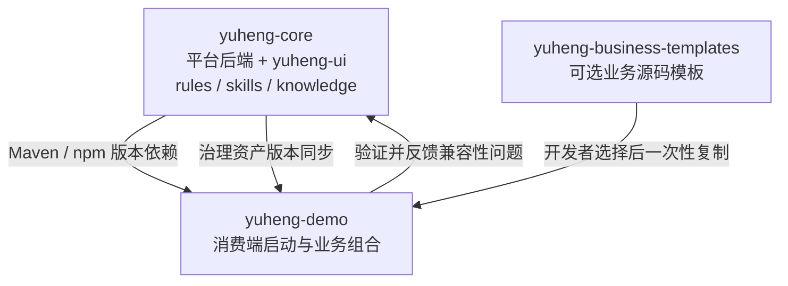

# Yuheng 三仓库架构与 SQL 治理设计

日期：2026-11-10  
状态：待用户审阅  
范围：明确 `yuheng-core`、`yuheng-business-templates`、`yuheng-demo` 的职责边界、消费方式、升级约定与 SQL 治理目标。

## 1. 背景与目标

Yuheng 已拆分为平台核心、业务模块模板和消费端示例三个独立仓库。需要明确它们的依赖方向和资产所有权，使业务开发者能够选择模板或自行创建模块，同时只依赖发布版 core，并持续采用 core 的前后端开发规范、rules 和 skills。

本设计定义目标架构和治理要求，不在本阶段修改运行时代码、升级迁移工具或同步 demo 快照。现有数据库结构与初始化数据仍以已核实的 SQL 基线为事实；把该基线转换为可运行的 Liquibase 链需要单独实施与验证。

## 2. 已确认决策

1. `yuheng-core` 是平台能力、公开契约及共享开发治理资产的唯一来源。
2. core 对消费端提供版本化后端 Maven 入口和正式前端包 `yuheng-ui`。`yuheng-ui` 是唯一正式 npm 包名，不使用 `@yuheng/platform-ui` 作为发布坐标。
3. Java 命名空间使用 `com.yuheng`。平台实现和公开 API 使用 core 定义的 `com.yuheng.platform.*` 契约；消费端与业务代码不得继续引入 `cn.iocoder.yudao.*`。
4. `yuheng-business-templates` 保存可选业务源码模板，不作为 demo 的 Maven、npm 或运行时依赖。
5. demo 选择模板后，将源码一次性复制到自身业务模块目录。复制后由 demo 完全维护，不支持模板仓库向 demo 更新或同步该份代码。
6. demo 可按自身需求创建不源自模板的新业务模块。
7. demo 通过版本依赖消费 core 运行时代码，通过版本化快照/同步机制消费 core 的 rules、skills 和 knowledge；开发与升级均须遵守 core 的治理要求。
8. 数据库迁移目标采用 Liquibase 作为应用统一入口。core 平台基线和 demo 业务迁移分链管理，由 demo 唯一入口按固定顺序组合执行；模板迁移随源码复制，导入后属于 demo 业务迁移。
9. 测试 fixture、安装基线、生产增量迁移和人工运维 SQL 是不同资产类型，必须分别标识，不能相互替代。

## 3. 仓库职责与依赖方向

### 3.1 `yuheng-core`

core 负责平台公共后端、平台 UI、公开扩展契约、发布版本和共享开发治理资产。消费端通过发布坐标使用 core；不得将 core 工作树、源码目录或内部模块路径作为应用运行依赖。

core 版本升级须让消费端能够识别并验证后端、`yuheng-ui`、governance 和 knowledge 的版本组合。平台表结构与 core 基础数据属于 core 数据资产，其生产变更进入 core baseline 迁移链，并随 core 版本发布。

### 3.2 `yuheng-business-templates`

该仓库提供可选择的业务模块源代码及导入说明。模板应遵循当前 core 的公开 API、UI 包入口、规则和 skills，并标明适配的 core 版本范围、所需平台能力、数据库资产和导入步骤。

模板复制后，其业务 Java、前端、SQL、迁移说明和模块配置归 demo 所有。模板仓库后续更新不会自动影响已导入的代码；需要新模板时由开发者重新选择并评估，而不是升级运行依赖。

### 3.3 `yuheng-demo`

demo 是消费端基线和业务开发示例。它负责 Spring Boot 启动、运行配置、数据源、Liquibase 主入口、core 与业务模块装配、最终打包，以及业务前端应用。

demo 可包含从模板复制的业务模块及自建模块。业务模块依赖 core 的稳定公开契约，不依赖 core 源码路径；业务代码、路由、迁移、权限和验证由 demo 自行维护。

## 4. 版本与升级

demo 应记录一次构建所用的 core 后端版本、`yuheng-ui` 版本、governance 版本、knowledge 版本，以及适用的数据库基线版本。版本可以按既有兼容策略独立演进，但实际消费组合必须由 manifest 或等价锁定文件表达，并通过兼容性检查。

core 升级流程应至少包括：选择目标版本；更新 Maven/npm 依赖与治理快照；核对数据库 baseline 及新增迁移；运行 demo 后端、前端和业务模块验证；执行 SQL 初始化或升级验证；记录实际通过的版本组合与结果。模板仓库不参与 demo 的 core 更新链。

若版本超出声明的兼容范围，或业务模块不能通过公开契约编译、启动或迁移验证，该组合不得标记为已验证。

## 5. SQL 资产与所有权

| SQL 资产 | 所有者 | 目的 | 执行方式 |
|---|---|---|---|
| core baseline 和后续平台增量 | `yuheng-core` | 平台、system、infra 表结构及基础数据 | 由 demo 主 Liquibase 链纳入并执行 |
| 模板中的业务变更 | 初始由模板仓库提供；复制后归 demo | 建立模板业务所需表、索引和必要初始化数据 | 复制进 demo 业务迁移目录，由 demo 主链纳入 |
| demo 自建业务迁移 | `yuheng-demo` | 消费端独有业务数据库演进 | 由 demo 主 Liquibase 链纳入 |
| 测试建表、清理和测试数据 | 对应模块/仓库 | 测试隔离与 fixture | 仅测试配置使用，不进入生产主链 |
| 一次性安装、修复或运维 SQL | 明确的维护方 | 特定环境操作或数据修复 | 单独审批、记录适用范围和执行证据，不作为常规 schema migration |

生产数据库变更以追加式、可追踪的 Liquibase changeset 表达。已执行 changeset 不得改写；修正通过后续 changeset 完成。外部 SQL 必须被已配置的 changelog 引用并可定位。应用使用一个主入口组合 core 与业务两条迁移链，顺序固定且可检查，避免重复或遗漏。

core baseline 的生成或切换必须考虑空库安装与已有数据库接入两种场景。已有数据库不得直接重放 create-table 快照；应先核对结构和数据基线，再采用经验证的基线登记/接续策略。不得通过忽略迁移错误或将失败 changeset 标记成功来绕过差异。

数据库方言只在有实际初始化、升级及业务验证证据时声明支持。MySQL 验证不能自动证明 PostgreSQL、DM 或其他方言兼容。模板应标明所需方言及脚本适用范围。

## 6. SQL 变更门禁与验证

每项数据库变更都应能追溯到业务/平台需求、表及字段归属、目标数据库方言、迁移文件和验证记录。提交或发布检查应覆盖：

- Liquibase changeset 的唯一标识、作者/归属、版本顺序与主入口引用；
- 历史已执行迁移未被修改、生产迁移未混入测试 fixture 或人工运维脚本；
- 表、字段、索引、约束、默认值、注释及租户字段符合数据契约；
- 空库初始化、重复检查/执行、从受支持旧基线升级及失败行为；
- 业务模块迁移与 core baseline 的 include 顺序及版本组合；
- 每个声明支持的数据库方言都有对应验证证据；
- 回滚或前向修复策略说明，以及数据变更的备份/恢复要求。

测试 SQL 不作为生产迁移已经存在的证据。没有可执行的主 changelog、真实依赖和运行配置前，治理工具不得声称数据库迁移门禁已通过。

## 7. 当前状态与实施缺口

截至本规格编写时，已检查到：

- core 的 Maven 多模块、`yuheng-server` 和 `yuheng-ui` 包工程已存在；core 主 Java 源码已迁移到 `com.yuheng` 命名空间。
- core 的发布清单仍有 `@yuheng/platform-ui` 与 `yuheng-ui` 的命名不一致，需要统一为 `yuheng-ui`。
- demo 的后端只声明版本化 `yuheng-server`，前端当前元数据使用 `yuheng-ui`；demo 默认控制器仍有 `cn.iocoder.yudao.*` import。
- 业务模板目前以源码目录提供；存在少量旧 Java import，需在模板质量门禁中阻止残留。
- demo 当前没有业务模块接入结构和应用级 Liquibase 入口。现有 postcheck 与 sync verify 因 demo 缺少 manifest、rules/skills 快照及必需文档目录而返回 `BLOCKED`。
- core 和模板仓库中的 `create_tables.sql` / `clean.sql` 属于测试资源；当前三仓库没有完整可运行的 core baseline + demo business Liquibase 链。
- ruoyi SQL 基线包含多种数据库方言。core 的数据库盘点已要求先决定首轮方言并建立表归属，不能假设现有快照已可直接转成 Liquibase。

上述现状是待实施事项，不代表本规格已经修复或验证这些问题。

## 8. 分阶段实施边界

该架构跨三个独立 Git 仓库，拆分为多个规格与实施计划，不作为一个大规模实施任务：

1. **消费契约与命名统一**：正式 npm 坐标统一为 `yuheng-ui`；清理 demo 与模板旧 Java import；统一发布清单、CI 和文档。
2. **demo 治理消费恢复**：恢复 core manifest/rules/skills/knowledge 的可验证消费流程，修复 postcheck 所需工程结构，并确认 CI 能在固定 core 版本上复现。
3. **SQL 基线与迁移架构**：确定首轮数据库方言，盘点 core 与业务表/初始化数据归属，设计现有数据库接入策略，建立 core baseline 与 demo 单一 entry changelog，并覆盖空库和升级验证。
4. **模板导入契约**：定义模板模块目录、一次性复制流程、demo 构建注册、前端路由和 Liquibase 文件导入规则；选取一个业务模块完成端到端验证。

每个阶段独立形成规格/计划和验证结果。阶段 3 在基线差异与已存在数据库接续方式得到证据前，不得批量将现有多方言 SQL 快照机械转换为生产 changeset。

## 9. 验收标准

- 三个仓库的依赖方向、源码所有权及模板复制后归属与本设计一致。
- `yuheng-demo` 后端与前端只使用版本化 core 入口；前端正式包名统一为 `yuheng-ui`。
- core rules、skills、knowledge 的消费版本可追溯，demo 的治理检查与固定版本源校验通过。
- 业务模板一次性复制后可纳入 demo；之后更改由 demo 独立维护，且模板仓库不作为运行依赖。
- Java 源码中不再有 `cn.iocoder.yudao.*` 引用。
- demo 存在唯一正式 Liquibase 入口，固定顺序组合 core baseline 与 demo 业务迁移；测试 SQL 和人工运维 SQL 不进入生产主链。
- 至少在声明的首个数据库方言上验证空库初始化、重复执行检查、从指定旧基线升级、失败处理和恢复方案。
- core 升级验证同时覆盖后端构建、`yuheng-ui` 测试/类型检查/构建、治理同步与 demo 业务数据库迁移。

## 10. 自检

- 本规格将目标设计与仓库现状分开陈述，没有把目标 Liquibase 入口误写为已存在能力。
- 版本升级对象与模板源码所有权没有冲突：core 产物和治理资产可升级，已复制业务源码由 demo 管理。
- SQL 所有权、单一执行入口、测试/运维脚本分类及已有数据库接续均有定义。
- 多数据库转换被限制为逐方言验证；不把 SQL 快照机械转换列为默认操作。
- 后续工作按消费契约、治理同步、SQL 基线、模板导入拆成独立规格/计划，范围可以分别评审和验收。
